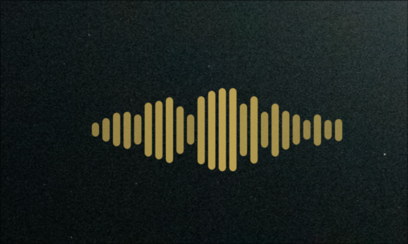

# Hyprwhspr Voice Overlay

An on-screen / desktop audio visualizer, built as a [DankMaterialShell](https://danklinux.com)
**desktop widget** (the same kind as Dank Audio Visualizer). A large mirrored equalizer that fades
in while there is audio.

Originally written for [hyprwhspr](https://github.com/goodroot/hyprwhspr) dictation (it read
hyprwhspr's IPC files); this fork adds a real audio source, so the widget also works with **no
hyprwhspr installed** — it follows system output, the microphone, or both.



## Features

- **Center envelope** (toggleable) — bars swell toward the middle, the classic voice-assistant
  silhouette.
- Organic motion: each bar gets two randomized, incommensurate sine components, so there is no
  visible "marching wave" loop.
- A **Primary → Secondary sweep** color mode that blends the theme colors across the row.
- Subtle pop-in (overshoot scale) when audio starts, a pulsing mic glyph, and a dim idle
  placeholder that keeps the widget selectable/resizable.
- **Cheap** — one long-lived `python3` helper (`audioLevel.py`) + one `pw-record` child. Measured
  0.6% CPU while monitoring, and the QML side is fully quiescent when the bars are at rest.
- Animation is a `FrameAnimation`: frame-synced and dt-correct (attack/release are real time
  constants, independent of refresh rate), and it pauses with the window. Bars are absolutely
  positioned, so per-frame height changes never trigger layout passes.

## Behavior

- **Audio present** → full-opacity animated equalizer + pulsing mic icon.
- **Idle** → controlled by the *When not recording* setting:
  - **Show dim placeholder** (default) — a faint outlined panel with resting bars, so the widget
    stays visible and you can move/resize it from the desktop-widget handles **without having to
    play anything**.
  - **Hidden (overlay only)** — fully transparent; only appears while there is audio.

Like all DMS desktop widgets it lives on the wallpaper/background layer, so it's visible on the
desktop and (with *Show on overview* enabled) on the overview overlay — not floating above
normal application windows. `dms ipc call desktopWidget setOverlay <instanceId> true` raises a
single instance to the overlay layer (handy for screenshots/tests).

## Data source

`audioLevel.py` (next to the component) prints one `R <level>` line per ~80 ms plus a single `I`
when audio stops; the QML side only parses those lines. Level is perceptual: linear RMS mapped
through dB (-50 dBFS → 0, -8 dBFS → 1).

Sources (`Audio source` setting):

| Value | What it listens to |
|---|---|
| `output` (default) | monitor of the default sink — music, videos, calls |
| `mic` | default microphone |
| `both` | max(mic, output) |
| `hyprwhspr` | `$XDG_CONFIG_HOME/hyprwhspr/recording_status` + `audio_level` |
| `auto` | `hyprwhspr` when that config directory exists, else `output` |

The gate is calibrated once per capture from a ~1 s median of the noise floor (capped at
-35 dBFS), so room hiss stays below it and sustained music can never raise the gate and kill the
bars.

## Install / use

Canonical copy lives in the workspace; the shell loads it through a symlink (DMS resolves plugin
symlinks — `dankGearyMail` uses the same trick):

```bash
git clone <this repo> ~/workspace/hyprwhspr-voice-overlay
ln -sfn ~/workspace/hyprwhspr-voice-overlay ~/.config/DankMaterialShell/plugins/hyprwhsprVoiceOverlay
dms restart   # desktop plugins are compiled at shell start
```

Desktop plugins are **not** enabled from the plugin list — add the widget from the
DankMaterialShell desktop-widget controls (Settings → Widgets, or the desktop widget picker),
then drag/resize it and toggle *Show on overview* / *Click-through* as desired.

## Settings

- **Audio source** — system output / microphone / both / hyprwhspr / auto (see table above).
- **When not recording** — dim placeholder (resizable) vs hidden (overlay only).
- **Bars** (6–48), **Center envelope**, **Sensitivity** (50–500%), **Motion speed** (25–250%).
  Sensitivity is a taste knob now (levels are already perceptual): 100% suits music and speech.
- **Color** — Primary / Secondary / Primary → Secondary sweep / Error / Custom.
- **Show mic glyph** — pulsing mic icon in the corner.
- **Show background panel** — translucent panel behind the bars for busy wallpapers.

## Requirements

- DankMaterialShell ≥ 1.2.0
- `python3`, PipeWire's `pw-record`, WirePlumber's `wpctl` (all present on a normal
  PipeWire desktop; no pip packages)
- hyprwhspr is **optional** (only for the `hyprwhspr` source)

## Pitfalls worth remembering

- **A PipeWire capture stream must target a node by `object.serial`, not `node.name`.**
  `pw-record --target <sink node.name>` silently falls back to the default source, so an
  "output monitor" happily reports the microphone and room noise. Verify what is really linked
  with `pw-dump` (`link.output.node` / `link.input.node` on the capture stream's links).
- **Gate on RMS, not RMS+peak.** Ambient hiss has a low RMS but a high peak; a peak-boosted
  signal reads as continuous audio and the bars never rest.
- **Do not let the noise gate self-calibrate while audio plays** — it climbs to the music level
  and the bars die mid-song. One-shot calibration with a capped gate instead.
- `pw-record --target <sink>` yields exactly 0 RMS when the sink is idle, which is what makes
  the `output` source clean.

## License

MIT

> Note: `DesktopPluginComponent` does **not** support `defaultWidth`/`defaultHeight`/`forceSquare`
> (despite older docs) — only `minWidth`/`minHeight`. Default size comes from the instance's saved
> position.

## 本机改动（2026-10，相对上游 v1.0.0）

- 新增 `audioLevel.py` 与设置项 `Audio source`：本机没装 hyprwhspr，上游版本只会永远停在待机
  小圆点、放声音也不动；现在默认跟随系统输出。
- 灵敏度默认 100%（原来 200% 是为线性 mic 电平准备的）、响应曲线 0.85。
- `plugin.json` 去掉了 `requires: ["hyprwhspr"]`，版本升到 1.1.0，无 hyprwhspr 也能加载。
- 实例 `dw_1793277313611_k6hd0a7wb`（1000×401，显示器居中），改完需 `dms restart`。
